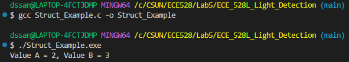
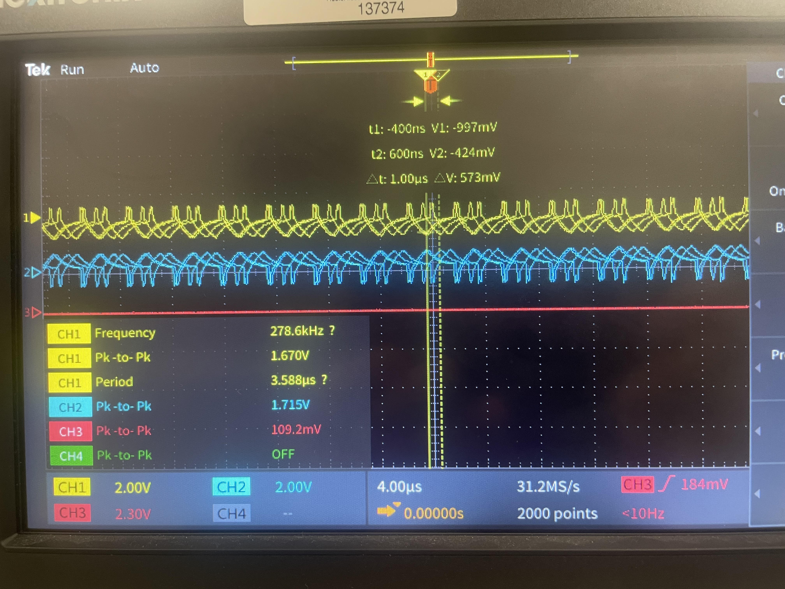
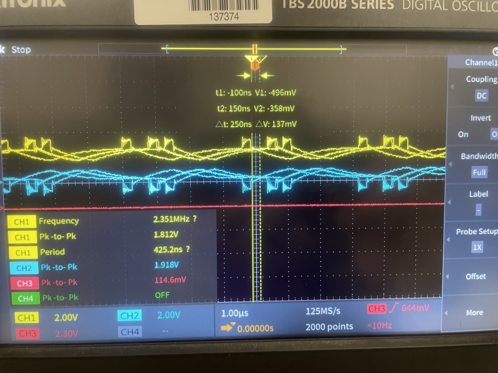

# ECE 528/L - Robotics and Embedded Systems Lab
**CSU Northridge**

**Department of Electrical and Computer Engineering**

## Overview

Title: Lab 5 - Light Detection

Author: Dominic Sanqui

Date: 12/3/26

Description: The purpose of this lab is to introduce the concept of I2C by integrating a Texas Instruments (TI) BP-BASSENSORSMKII BoosterPack module into the MSP432 Launchpad and communicate to it via I2C. This BoosterPack module will allow the Launchpad to process light. The value from processing the light will be used for various tasks.

## Components Used
- 1 TI-RSLK MAX
- 1 Flashlight
- 1 USB-A to Micro-USB Cable
- 1 Breadboard
- Jumper cables
- Oscilloscope with Probes
- 2 Pololu Gearmotor with Encoder - [Product Link](https://www.pololu.com/product/3675)
- OPT3001 Ambient Light Sensor - TI BP-BASSENSORSMKII BoosterPack - [Product Link](https://www.ti.com/tool/BP-BASSENSORSMKII)

## Prelab

1. What is lux? What formula is used to calculate the lux measured by the OPT3001 Ambient Light Sensor? Refer to the OPT3001 Datasheet in the Result Register Section (7.6.1.1.1).

Lux is defined as the amount of light that is applied to a surface. Mathematically, it is defined as 1 lumen per square meter. This value is used to determine how effective a light fixture is in an area. This is useful for people interested in infrastructure, because it can act as a measurement on how well an area is lit for safety reasons [1].

The formula to calculate lux is [2]:
lux = 0.01 * (2 ^ (E[3:0])) * R[11:0]

2. What possible I2C addresses can be used by the OPT3001 Ambient Light Sensor? In a table, list the addresses in hexadecimal format and provide each pin connection. Refer to the OPT3001 Datasheet in the Serial Bus Address Section (7.3.4.1).

Table 1. Table for Prelab Question 2 [2]
| DEVICE I2C ADDRESS | ADDR PIN |
| ------------------ | -------- |
| 0x44               | GND      |
| 0x45               | VDD      |
| 0x46               | SDA      |
| 0x47               | SCL      |

3. What is a struct in C? What can it be used for? Provide an example of using a struct by writing a short program that defines a struct with two int members. Initialize the members of the struct with any values of your choice and print out their values.

A struct is a technique to group variables that have some kind of relation together into a single group. Variables within a struct are defined as a member of that struct and can only be accessed through the struct. Structs can be used to combine relevant variables and information together. Additionally, structs can act as a template and can be used many times [3]. 

```
#include <stdio.h>
#include <stdlib.h>

struct myStruct
{
    int myVar_A;
    int myVar_B;
};

int main() 
{
    struct myStruct exampleStruct = {2, 3};

    printf("Value A = %d, Value B = %d\n", exampleStruct.myVar_A, exampleStruct.myVar_B);
    return 0;
}
```

Figure 1. Test Results for Prelab Question 3



## Analysis and Results

For this lab, the work has been divided into the procedure section and one task section. For the procedure, the first step is to integrate the the TI BP-BASSENSORSMKII BoosterPack module into the TI-RSLK MAX. The BoosterPack module contains a OPT3001 Ambient Light Sensor which is used to read the intensity of the light pouring into the sensor and convert it into a numerical value. This would would be used by the TI-RSLK MAX to drive or stop the motors. Then, the next step would be to capture the signals generated via an oscilloscope. This would allow a user to read and interpret the signals to verify that the TI-RSLK MAX and TI BP-BASSENSORMKII BoosterPack module are properly communicating via the I2C technique.

The signals from the oscilloscope are shown in Figures 2-3. Unfortunately, these signals appear nothing as expected in the lab instructions. Ideally, a clean signal would allow a user to verify that the SCL line was properly generating a constant clock, the SDA line was sending the correct data bits, and that the debug signal was working as expected. None of those were possible. When running continuously, the signals could never make a precise square wave. When running in single mode, every signal would be set to 0 which tells a user nothing. Per the professor's guidance, these signals can be used in the report but the errors with them should be noted. Further details are shown in the Known Issues or Limitations section.

Figure 2. I2C Protocol of Entire Transaction




Figure 3. I2C Protocol of Single Transaction

 

With the completion of the procedure section, the final half of the lab report is to complete the task section. For the task, the Controller_1() function will need to be modified to change the speed of the motors based on the value of the lux measured from the OPT3001 sensor. The new Controller_1() function will compare the measured lux value against the minimum lux needed to move the robot. In this case, the minimum lux value is set to 10,000 because the OPT3001 sensor can detect up to approximately 83,000 lux based on testing during the procedure section. If the measured lux value is below the threshold, then the motors are stopped and LEDs are turned on to indicate that the robot has not received enough lux. 

If the measured lux value is equal to or above the threshold, then the function calculates how much is received compared to the maximum value as a percentage. For ease of calculations, the maximum lux threshold has been set to 83,000. The measured lux is divided by the maximum lux threshold and is multiplied by 100 to calculate the percentage. Based on the percentage, there are six types of duty cycles that the robot will use. The following table displays the entire range set for duty cycles based on the percentage value. The calculated lux percentage is defiend as x in the table. To calculate the duty cycle, the maximum duty cycle is multiplied by a ratio which is then fed into the Motor_Forward function. The highest ratio is 0.6 to ensure that the motors are never given a duty cycle greater than 70%. For each duty cycle, the LED2 is set to a specific color to indicate what speed the motors are moving at. The proof of the lab is shown in a video at the link below. 

Table 2. Lux to Duty Cycle Map for Task
| Lux Percentage | Duty Cycle Percentage | LED2 Color |
| -------------- | --------------------- | ---------- |
| x < 25%        | 10%                   | BLUE       |
| 25% <= x < 35% | 20%                   | YELLOW     |
| 35% <= x < 45% | 30%                   | PINK       |
| 45% <= x < 55% | 40%                   | SKY BLUE   |
| 55% <= x < 65% | 50%                   | WHITE      |
| x > 65%        | 60%                   | GREEN      |

Video Demonstration:

[Video Link](https://www.youtube.com/shorts/33udW_tP1Yo)

## Known Issues or Limitations

It was unknown why the signals captured in the oscilloscope for the Procedure section were acting so oddly. It was impossible to capture signal signals for any of the waveforms. It appeared that the debug waveform was stuck at 0. The professor reviewed the connection and determined that the connection was fine. Additionally, the robot was able to drive the motors based on the light received, so this confirms that the physical hardware has been connected properly and the software was written correctly. The guidance provided by the professor was to use these signals but explain the issues in the lab report.

Another issue with this lab was encountered during the completion of the task. When the OPT3001 sensor has been exposed to the maximum amount of light for a significant period of time, the sensor becomes overwhelmed and is no longer able to operate. Even when the Sample_Light_Sensor() function is called and the flashlight was turned off, the robot was permanently stuck at the max speed. The best theory is that the register value overflows and be permanently stuck to the maximum value. The best method to circumvent this issue is to ensure that the flashlight does not shine at the sensor at maximum strength for too long.   

## Postlab

1. What would happen to the shape of the SCL and SDA signals if the values of the pull-up resistors were significantly increased?
If the value of the pull up resistors were increased, the capacitors will need a longer time to charge which increases the length of the rise time for these signals. This can cause the SCL and SDA signals to take longer to change states which could potentially lead to loss of data or corrupted data [4].

2. How can multiple peripheral devices use the same I2C bus? How does the main I2C controller know when to transmit or receive data from the peripheral device?
In I2C, there can be a master with multiple slave devices. The master will send a start condition via the SDA line to every slave device which will inform the slave devices to be ready to receive data. The master will then send an address to all of the slave devices. The slave device that is mapped to that address will respond to the master address that it is either ready or not ready to begin the process of transmitting or receiving. Essentially, multiple slave devices can exist on the same I2C bus because the master will only transmit to or receive data from a slave device tied to a specific address [5].

3. What are some advantages and disadvantages of using I2C? List at least three reasons for each.

Advantages:
- Since this technique uses only 2 wires, the physical space needed to implement this technique is small which allows for effective utilization of space in a system.
- Allows for multiple slave and master devices with a simple process by specifying the slave device needed with an address call
- Acknowledgement and non-acknowledgement signals can be used to identify that data was transferred correctly

Disadvantages: 
- Slower compared to SPI
- Limited to sending only 8-bit data frames
- Can be confusing to use when there are too many slave and master devices
[5]

4. Based on your results from the Procedure section, what was your measured SCL clock frequency? Is this value higher or lower than the expected SCL frequency? If there is a discrepancy between the measured and expected clock frequency values, explain why.

Due to the issues with the oscilloscope, it is impossible to tell what the SCL clock frequency is. 

## References
[1] “What is Lux? guide to measuring light on surfaces,” Commercial Lighting Industries, https://www.commercial-lighting.net/what-is-lux/ (accessed Nov. 22, 2026). 

[2] “OPT3001 ambient light sensor (ALS),” Texas Instruments, https://www.ti.com/lit/ds/symlink/opt3001.pdf?ts=1795292029679&ref_url=https%253A%252F%252Fwww.google.com%252F (accessed Nov. 22, 2026). 

[3] “C structures (structs),” W3Schools, https://www.w3schools.com/c/c_structs.php (accessed Nov. 22, 2026). 

[4] J. Hopkins, “What are I2C pull-up resistors and how to calculate their values,” Total Phase Blog, https://www.totalphase.com/blog/2024/07/what-are-i2c-pull-up-resistors-calculate-their-values/ (accessed Nov. 22, 2026). 

[5] B. Murphy, “Understanding I2C communication and how to debug the I2C protocol?,” Total Phase Blog, https://www.totalphase.com/blog/2020/07/understanding-i2c-communication-and-how-to-debug-the-i2c-protocol/ (accessed Nov. 22, 2026). 